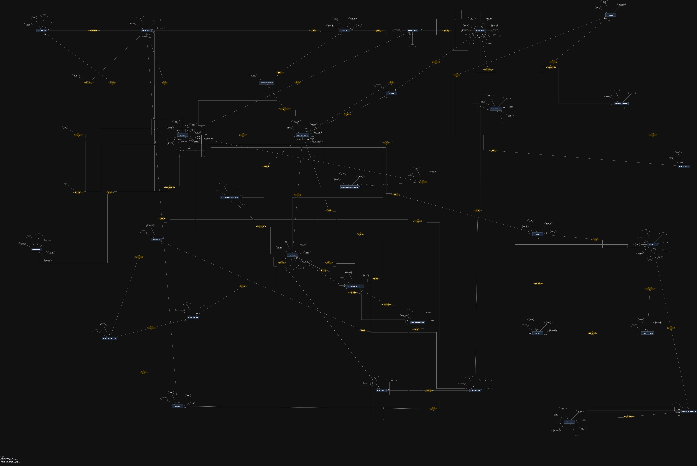
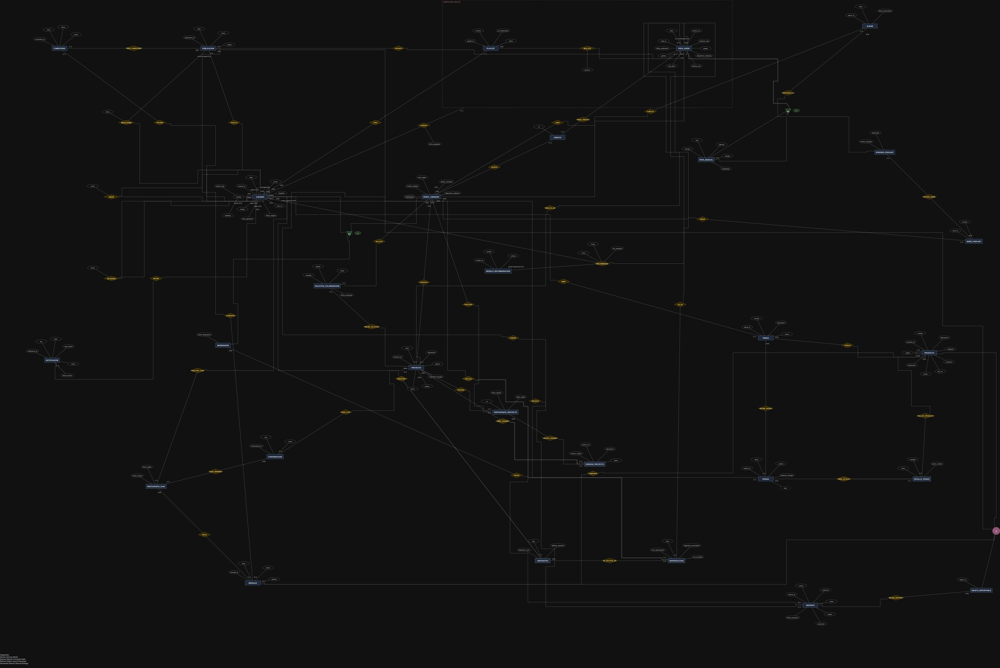
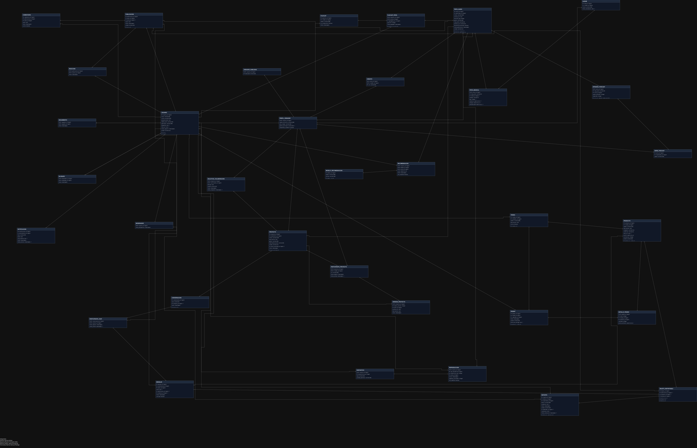

# Natfy: proyecto de red social musical

## Diagramas finales de Natfy

Nombre provisional del proyecto: **Natfy**. Las imágenes siguientes corresponden a las cuatro pestañas del [archivo editable de draw.io](proyecto-propio/NATFY-DIAGRAMAS-FINALES.drawio).

### Modelo entidad-relación — Práctica 1

### Modelo EER — Notación Peter Chen — Práctica 2

Entidades, atributos, relaciones, cardinalidades, entidades débiles, especializaciones ISA y categoría de unión.

### Modelo EER — Notación Crow's Foot — Práctica 2

Tablas con claves PK/FK y símbolos de pata de cuervo para las cardinalidades.

### Modelo relacional — Práctica 3

Tablas, columnas, tipos de datos, claves primarias, claves foráneas y conexiones entre tablas.

Las imágenes están disponibles en PNG y SVG. Haz clic en cada imagen para abrir la versión vectorial y ampliar los detalles.

---

## Alcance del repositorio

Natfy es el nombre provisional del proyecto propio: una red social musical con perfiles, publicaciones, seguidores, conversaciones, colaboración en proyectos y marketplace.

El proyecto asignado de Sismos y sus entregables continúan en [Proyecto-Asig-Sismos](https://github.com/Samuel-Hdzx07/Proyecto-Asig-Sismos). Sus resúmenes, propuestas, evidencias y cambios de esquema se trasladaron allí. Los issues históricos de Sismos conservan su dirección original; no se alteró su autoría ni se duplicaron como aportaciones nuevas.

## Integrantes indicados en los materiales

- Damas Garnica Adrian
- Esparza Ramón Fernando Adán
- Ramos Padrón Jesus Emmanuel
- Hernandez Barrios Samuel Rodrigo (Boleta: 2026630008)

Grupo: 3CV4. Carrera: Ingeniería en Sistemas Computacionales. Los nombres se conservan del material recibido; la composición definitiva de los equipos separados debe confirmarse.

## Práctica 1

- [Investigación sobre bases de datos](docs/investigacion-bases-de-datos.pdf).
- [Estado del arte](docs/estado-del-arte.pdf).
- [Caso de estudio de Natfy](docs/caso-de-estudio.pdf).
- [Git y Docker](docs/ejercicios-1-2-git-docker.pdf).
- [Entorno PostgreSQL](entorno/compose.yaml).

## Modelado y exposición de Natfy

- [Requisitos ampliados](proyecto-propio/requisitos-ampliados.pdf).
- [Archivo editable con cuatro pestañas](proyecto-propio/NATFY-DIAGRAMAS-FINALES.drawio).
- [Presentación de Natfy en PDF](evidencias/exposicion/presentacion.pdf).
- [Presentación editable](evidencias/exposicion/presentacion.pptx).
- [Guion](evidencias/exposicion/guion.md).
- [Estado de revisión](evidencias/revision-equipo.md).

Herramienta de diagramación: draw.io, por su edición de las cuatro notaciones y exportación a PNG y SVG. Los cuatro diagramas aprobados se conservan sin cambios durante el traslado.

## Integridad académica e IA

Codex (OpenAI) apoyó la revisión y distribución de diagramas, la actualización documental, los requisitos y la separación de la presentación por proyecto. Los integrantes deben revisar y comprender el material. Incluir un nombre en la portada no acredita participación ni sustituye una revisión real de un compañero.
